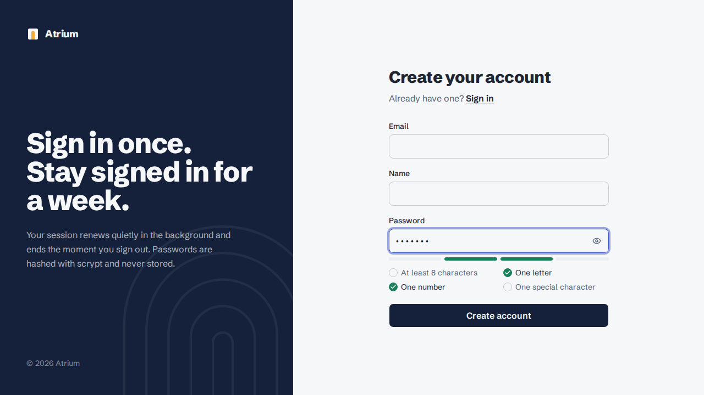
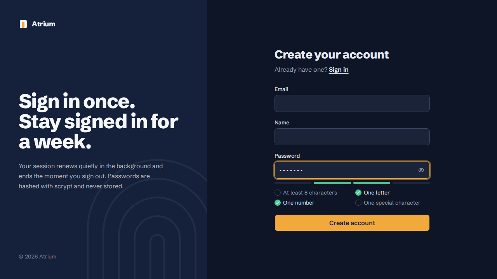
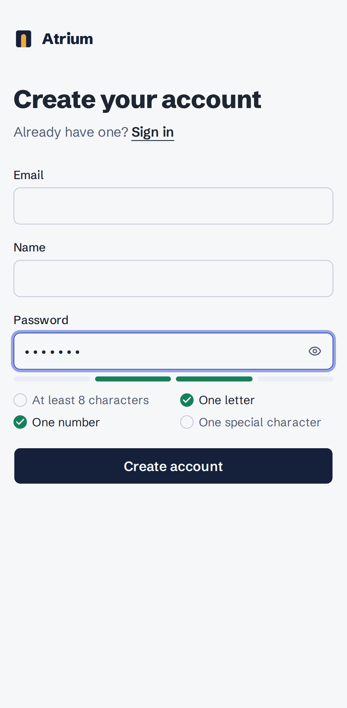

# Atrium: sign up / sign in module

A production-minded authentication module: **NestJS 12 + MongoDB** API and a **React 19 +
TypeScript** web app, in one pnpm monorepo.



| Sign up (dark mode)                        | Mobile                                         | Application page                                 |
| ------------------------------------------ | ---------------------------------------------- | ------------------------------------------------ |
|  |  |  |

- **Why things are the way they are:** [docs/DECISIONS.md](docs/DECISIONS.md)
- **How AI was used:** [AI.md](AI.md)

---

## Requirements → where they are met

| Requirement                                                            | Implementation                                                                                                                                                                  |
| ---------------------------------------------------------------------- | ------------------------------------------------------------------------------------------------------------------------------------------------------------------------------- |
| React or Vue, TypeScript                                               | React 19, strict TypeScript everywhere                                                                                                                                          |
| Sign-up form: email, name (≥3), password (≥8, letter, number, special) | [`packages/shared/src/auth.schemas.ts`](packages/shared/src/auth.schemas.ts): **one Zod schema** used by the form _and_ the API. A live checklist shows each rule as it is met. |
| Sign-in form: email, password                                          | [`apps/web/src/features/auth/pages/sign-in-page.tsx`](apps/web/src/features/auth/pages/sign-in-page.tsx)                                                                        |
| Application page: "Welcome to the application." + logout               | [`apps/web/src/features/workspace/welcome-page.tsx`](apps/web/src/features/workspace/welcome-page.tsx)                                                                          |
| NestJS + MongoDB                                                       | NestJS 12, Mongoose 9 via `@nestjs/mongoose`                                                                                                                                    |
| Sign-up / sign-in endpoints honouring the field rules                  | `POST /api/v1/auth/signup`, `POST /api/v1/auth/signin`, validated with the shared schemas                                                                                       |
| At least one protected endpoint                                        | `GET /api/v1/users/me`. Every route is protected by default; public ones opt out with `@Public()`.                                                                              |
| README                                                                 | This file                                                                                                                                                                       |
| AI.md                                                                  | [AI.md](AI.md)                                                                                                                                                                  |
| _Bonus:_ logging, error handling, tests, CI/CD, API docs               | pino structured logs with request ids; uniform error body; 127 unit/integration tests and 14 browser tests; GitHub Actions; Swagger at `/api/docs`                              |

## Quick start (Docker, ~2 minutes)

Requires Docker.

```bash
cp .env.example .env
echo "JWT_SECRET=$(openssl rand -base64 32)" > .env
docker compose up --build
```

- App: http://localhost:8080
- API docs (Swagger UI): http://localhost:8080/api/docs

nginx serves the web app and proxies `/api` to the API, so the browser only ever talks to one
origin.

## Local development

Requires Node 24 and Docker (for MongoDB).

```bash
corepack enable                      # provides the pinned pnpm version
pnpm install
docker compose up -d mongo           # MongoDB on localhost:27017
cp apps/api/.env.example apps/api/.env
# then set JWT_SECRET in apps/api/.env:  openssl rand -base64 32
pnpm dev                             # API on :3000, web app on :5173 (Vite proxies /api)
```

- App: http://localhost:5173
- Swagger UI: http://localhost:3000/api/docs
- Health: http://localhost:3000/health (liveness), http://localhost:3000/ready (MongoDB check)

### Scripts (from the repository root)

| Command          | What it does                                                                                                                                 |
| ---------------- | -------------------------------------------------------------------------------------------------------------------------------------------- |
| `pnpm dev`       | Builds the shared package, then runs API and web app in watch mode                                                                           |
| `pnpm test`      | Unit + integration tests of every package (API tests use in-memory MongoDB)                                                                  |
| `pnpm test:cov`  | Same, with coverage reports and an 80% threshold                                                                                             |
| `pnpm test:e2e`  | Playwright against the production builds (needs MongoDB on :27017 and `pnpm build`; run `pnpm --filter @auth-app/e2e install-browsers` once) |
| `pnpm lint`      | oxlint (type-aware on the API)                                                                                                               |
| `pnpm typecheck` | TypeScript, every package                                                                                                                    |
| `pnpm build`     | Production builds                                                                                                                            |
| `pnpm format`    | Prettier                                                                                                                                     |

To run the browser tests against the Docker stack instead:
`AUTH_THROTTLE_LIMIT=1000 docker compose up -d` then
`E2E_BASE_URL=http://localhost:8080 pnpm test:e2e`. The default limit of 5 sign-in attempts per
minute per IP would otherwise (correctly) block the test run.

## Repository layout

```
apps/
  api/                 NestJS API
    src/auth/          sign up/in, refresh, logout, JWT provider, MongoDB refresh-token store
    src/users/         user schema, repository, GET /users/me
    src/common/        global exception filter, request ids
    src/config/        environment schema (validated at startup)
    src/health/  src/logging/  src/rate-limit/  src/docs/
    test/              e2e tests (Supertest + in-memory MongoDB)
  web/                 React app
    src/features/auth/ pages, form components, session provider, route guards
    src/lib/api/       fetch wrapper: token in memory, refresh-and-retry, typed errors
    nginx.conf         production web server + same-origin API proxy
packages/shared/       Zod schemas for requests and responses, shared by API and web
e2e/                   Playwright tests of the whole stack
docs/DECISIONS.md      architecture decisions and trade-offs
```

## API

Base path `/api/v1`. Full, interactive reference in Swagger UI.

| Method | Path                            | Auth           | Success                                             | Errors             |
| ------ | ------------------------------- | -------------- | --------------------------------------------------- | ------------------ |
| POST   | `/auth/signup`                  | public         | `201` `{ accessToken, expiresIn, user }` + cookie   | 400, 409, 429      |
| POST   | `/auth/signin`                  | public         | `200` `{ accessToken, expiresIn, user }` + cookie   | 400, 401, 429      |
| POST   | `/auth/refresh`                 | refresh cookie | `200` `{ accessToken, expiresIn }` + rotated cookie | 401                |
| POST   | `/auth/logout`                  | refresh cookie | `204`, cookie cleared, session revoked              | —                  |
| GET    | `/users/me`                     | `Bearer` token | `200` `{ id, email, name, createdAt }`              | 401                |
| GET    | `/health`, `/ready` (no prefix) | public         | liveness / readiness                                | 503 when not ready |

Every error has the same body:

```json
{
  "statusCode": 400,
  "error": "Bad Request",
  "message": ["password: Password must contain at least one number"],
  "path": "/api/v1/auth/signup",
  "timestamp": "2026-11-25T12:00:00.000Z",
  "requestId": "6f1c…"
}
```

## How the session works

```
 sign in ──► API ──► { accessToken (15 min) }  + Set-Cookie: refresh_token (7 days, httpOnly,
                                                  SameSite=Strict, Path=/api/v1/auth)
 requests ──► Authorization: Bearer <accessToken>        (token kept in memory only)
 401 ──► POST /auth/refresh (cookie) ──► new access token + rotated cookie ──► retry once
 reload ──► POST /auth/refresh ──► GET /users/me         (session restored, nothing in localStorage)
 reused refresh token ──► whole session revoked           (token theft detection)
```

More detail and the alternatives considered: [docs/DECISIONS.md §4–7](docs/DECISIONS.md).

## Security at a glance

- Passwords hashed with scrypt (`@nestjs/authentication`'s `PasswordHasher`); the hash never leaves
  the repository layer.
- Sign-in answers a wrong password and an unknown email identically, with matching timing.
- Refresh tokens: single use, stored as SHA-256, rotated on every use, reuse revokes the session.
- helmet headers, strict CSP in nginx, Fetch-Metadata CSRF protection on top of SameSite=Strict.
- Rate limits: 5 sign-in/sign-up attempts per minute per IP, 10 per 15 minutes per account,
  100 requests per minute overall. Counts are in memory, per API instance.
- Strict request schemas reject unknown fields; environment validated at boot (32-byte JWT secret).
- Logs redact authorization headers, cookies, passwords and tokens.

## Testing

| Suite                                | Tests | Notes                                                                    |
| ------------------------------------ | ----- | ------------------------------------------------------------------------ |
| `packages/shared`                    | 34    | every field rule and edge case                                           |
| `apps/api` unit + integration        | 35    | services, repository and refresh-token store on real (in-memory) MongoDB |
| `apps/api` e2e                       | 25    | every route through the real app: cookies, rotation, reuse, CSRF, 429s   |
| `apps/web`                           | 33    | forms, guards, session restore, refresh-and-retry (MSW fake API)         |
| `e2e` (Playwright, desktop + mobile) | 14    | real browser → nginx/Vite → API → MongoDB                                |

Line coverage: API 99%, web 98%, shared 100%.

The MongoDB refresh-token store is also checked against `@nestjs/authentication`'s official
store contract suite, including the case where two refreshes of one token race.

## Configuration

All API settings are environment variables, validated at startup by
[`apps/api/src/config/env.schema.ts`](apps/api/src/config/env.schema.ts). See
[`apps/api/.env.example`](apps/api/.env.example) for the full list with defaults. Only
`MONGODB_URI` and `JWT_SECRET` are required.

## What I would add next

- Email verification and password reset (the auth package supports both; they need an email
  provider).
- MongoDB authentication and TLS termination in the compose file for a shared deployment.
- Redis-backed rate limiting once the API runs on more than one instance.
- Route-level code splitting (the JS bundle is ~167 kB gzipped, mostly React and Zod).
